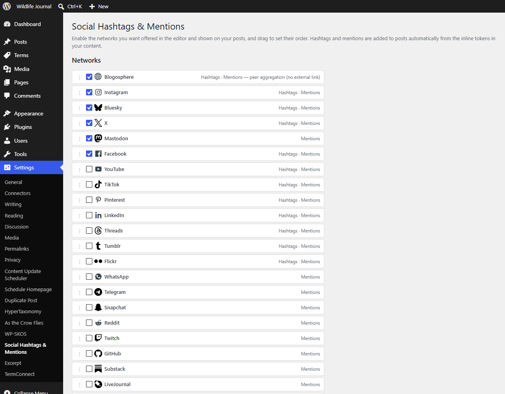
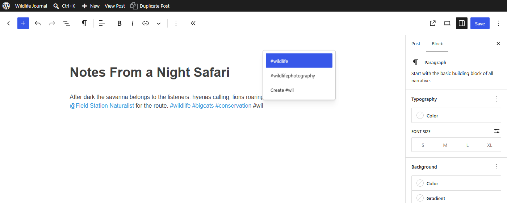
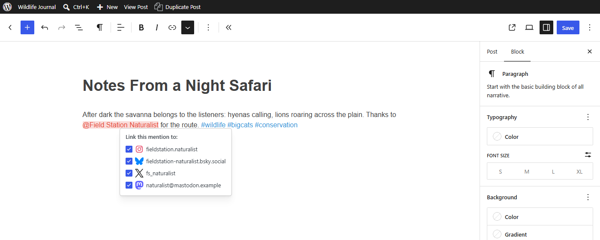
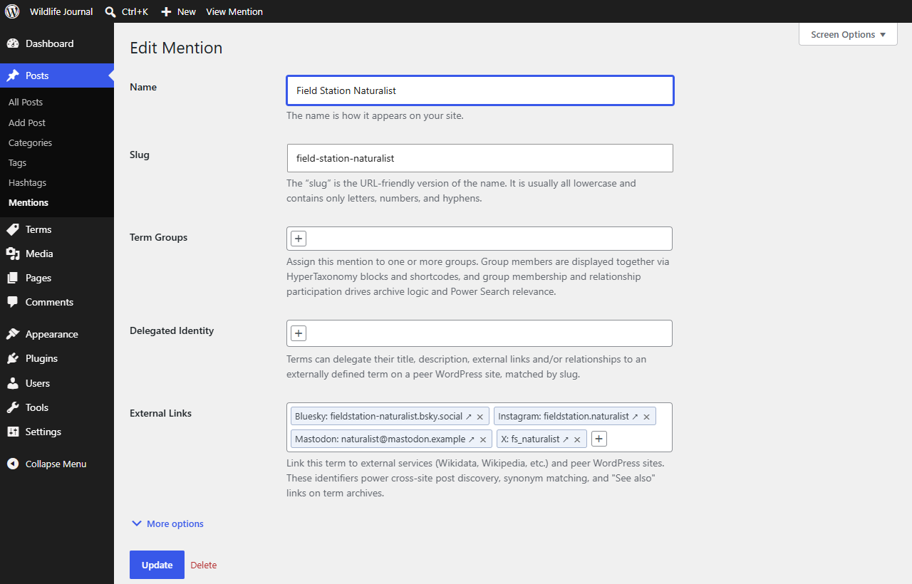
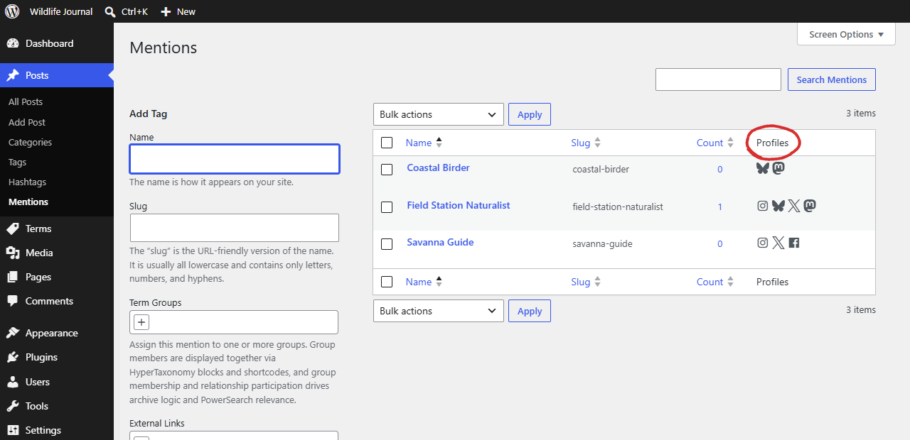
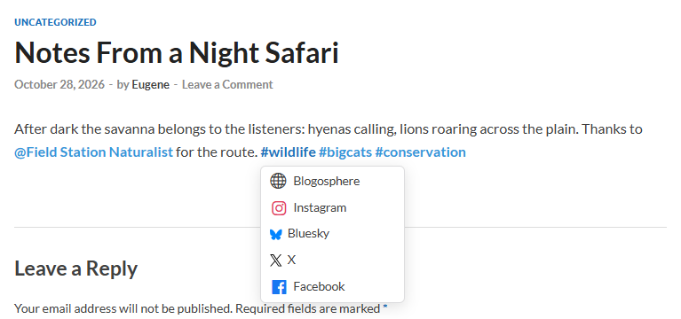
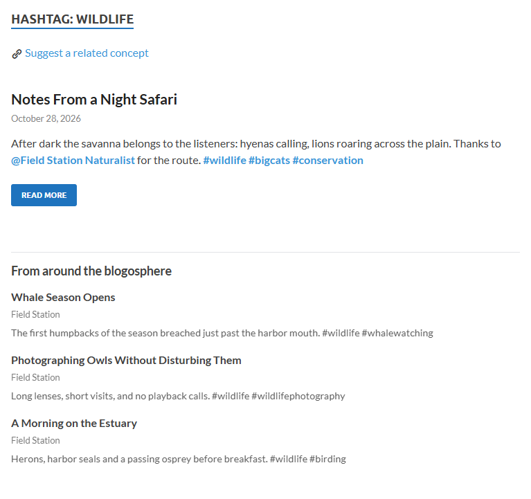

# User Guide

How to choose the networks your hashtags and mentions link to, write tokens in the block editor, decide what each one links to, and show posts from peer sites on hashtag archives. For the filters and REST endpoints, see the [Developer Reference](developer-reference.html).

## Enabling and ordering networks

Go to **Settings → Social Hashtags & Mentions**. All networks start disabled, including Blogosphere, so until you enable one, tokens only link to the local archive. Each supported network has a row you can:

- **Enable / disable** with its checkbox. Disabling a network removes its links from every post at once.
- **Drag to reorder** (the move handle on the left). The order here is the order networks are offered in the editor and rendered on the front end.



Networks declare which taxonomies they support — about half support both hashtags and mentions, and the rest are mention-only (e.g. GitHub, Reddit). Mastodon is also instance-based, so a handle is `user@instance`.

Two display options live on the same screen:

- **Blogosphere** — auto-append the aggregated peer-post section to hashtag archives (see below).
- **Tokens with no enabled links** — link them to the local archive, or render them as plain text.

The **Delete data on uninstall** option is at the bottom of the screen; see [Uninstalling](#uninstalling).

## Writing hashtags and mentions

In any rich-text field in the block editor, type `#` or `@`. This works in posts by default; developers can add other post types with the `sh_token_post_types` filter. An autocomplete list appears:

- `#` — searches existing **hashtag** terms; choose one, or pick "Create #…" to make a new one.
- `@` — searches existing **mention** terms and your **local users** in one combined list. Picking a local user ties the mention to that person's account (not just their display name), and automatically sets the term's "Local site" profile link the first time — so two different users who happen to share a display name are never merged into the same mention.



Selecting an item inserts a styled token. Terms are created and assigned to the post **automatically when you save** — there is no separate taxonomy box.

### Turning existing text into a token

You can also tokenize text you have already written: **select a word or phrase and click the `#` or `@` button in the block toolbar** — the same way the editor's link button works.

- **`#`** wraps the first word of the selection as a hashtag (a hashtag is a single word). A `#` already sitting in front of the word is reused, not duplicated.
- **`@`** wraps the whole selection as a mention, so multi-word names and forms like `@user@host` or `C#` are kept intact.
- Click **Apply** in the panel to keep the token; press **Escape** or click away to cancel and leave the text untouched.

The button is unavailable when the selection is part of an ordinary link (remove the link first) or already carries the other token type.

### Choosing networks for a token

Place the caret inside a token and a small panel opens (or click the toolbar button):

- **Hashtag** — tick the networks this particular hashtag should link to. (By default a token links to all enabled networks.)
- **Mention** — tick which of this person's **configured profiles** to show for this instance. The panel lists only the networks where the term already has a handle; untick any you want to omit here.



#### Setting a person's handles and profiles

A mention's identifiers are configured once, on the **mention term's edit screen** (**Posts → Mentions** → edit a term → *External links*), and reused everywhere that person is mentioned:

- **Social handles** — for networks with a public profile search (currently **GitHub** and **Bluesky**) the field autocompletes; for the rest, type the handle directly (a pasted profile URL or a leading `@` is cleaned up automatically).
- **Peer sites** — a WordPress-peer link on a mention searches that peer's **authors** (a person is an author there, not a tag) and links to their author profile.
- **Local site** — the built-in "Local site" entry maps the mention to a **local** author profile the same way.



The **Posts → Hashtags** and **Posts → Mentions** lists have **Networks** and **Profiles** columns showing what each term links to.



## How tokens render on the front end

The links are computed at display time from the per-token selection intersected with the networks currently enabled in settings.

[{: .screenshot-small}](assets/images/screenshots/front-end-tokens.png)

- **Hashtag with one network** → the token links directly to that network's hashtag page. If that one is Blogosphere, it links to the local archive.
- **Hashtag with several networks** → clicking the token opens a small pane listing each network, with Blogosphere linking to the local archive.
- **Hashtag with no enabled networks** → links to the local archive, or plain text (per the setting).
- **Mention with one profile** → the token renders inline as the network icon + handle, linking to that profile (in place of the `@name`). A profile on this site keeps the `@name` instead.
- **Mention with several profiles** → the `@name` stays and clicking it opens a pane of icon + handle links. Social networks show as "handle (Name)" and WordPress author profiles as "Name @ Site".
- **Mention with no profiles** → links to the local archive, or plain text (the same setting as hashtags).

## The Blogosphere section

The built-in **Blogosphere** gathers post **summaries** sharing a hashtag from your configured WordPress peer sites (set up in TermConnect) and shows them on the hashtag archive. A peer only contributes if it also has a `hashtag` taxonomy, which means running this plugin too. Each summary links out to the peer's own post — nothing is copied locally. (The aggregated-summaries feature is hashtag-only; for **mentions**, enabling Blogosphere acts as the on/off gate for showing a person's WordPress author profiles across your peer sites.)

[{: .screenshot-small}](assets/images/screenshots/blogosphere.png)

Enable the **Blogosphere** network in settings to turn it on. With **auto-append** enabled it appears automatically on hashtag archives. For precise placement — especially in block themes — use the shortcode:

```
[social_blogosphere]
```

On a hashtag archive it defaults to the current hashtag. Elsewhere, name one. `per_page` defaults to 10:

```
[social_blogosphere hashtag="example" per_page="10"]
```

The section paginates independently of the page's own pagination.

## Cross-site matching

Because Social Hashtags & Mentions is built on TermConnect, hashtags and mentions can work across peer sites that also run this plugin and TermConnect. Hashtags are matched by slug. Mentions are matched by their shared network handle (the resulting profile URI), so the same person is recognized even when the term slug or label differs from site to site.

## Uninstalling

Deactivating the plugin never deletes anything. Deleting it from the **Plugins** screen removes its settings and cached Blogosphere posts, and always keeps your hashtag and mention terms.

Mention handles and links to local users are kept too, so a reinstall works as before, unless **Delete data on uninstall** is on.
